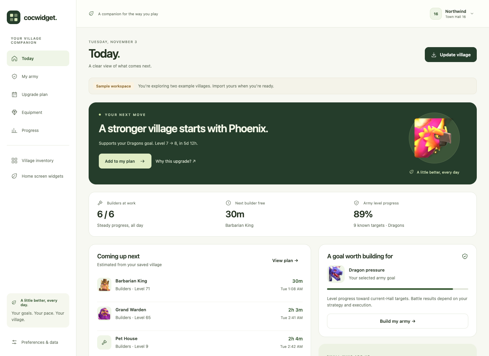

# COCWidget

A local-first Clash of Clans companion for **iOS and Android**. Turn a village export into a useful next action, a practical upgrade plan, equipment targets and visible progress. Native home-screen widgets keep selected villages close at hand.



## What works

- **Today and My army:** three curated army templates, current-hall targets, explained priorities, prerequisites and war-date protection.
- **Upgrade plan:** editable queue, independent builder/research/pet/Base lanes, online hours, estimated costs, and supported potion/book comparisons.
- **Equipment:** owned levels, target levels, ability breakpoints, exact catalogue ore sums and manually entered balances.
- **Progress:** saved snapshots, wall/hero changes, history comparison and a shareable text report.
- **Multiple villages:** separate goals, queues and history; widget configuration by village or all-villages overview.
- **Import and recovery:** paste, JSON file or validated application link; review before saving; raw/unknown fields preserved; backup/restore and explicit deletion.

The first launch has two clearly labeled sample villages. Personal exports stay in local application storage. No account, API key or backend is needed.

## Run locally

Use **Node 22 LTS** (`.nvmrc` is included):

```sh
nvm use
npm ci
npm run web
```

The browser runs the real app/domain logic and persists locally. Native widgets require a native build; they are not installed by the browser or Expo Go.

For Android, install Android Studio/SDK and a supported JDK, start an emulator or connect a device, then run:

```sh
npm run android
```

For iOS, install full Xcode and its simulator components, then run:

```sh
npm run ios
```

Generated `android/` and `ios/` projects are ignored. Native source lives in the local Android module, widget TypeScript and Expo configuration; `npx expo prebuild` recreates the projects. iOS device signing and the App Group require your Apple team configuration. A physical phone build is required to test the Shortcut end to end.

## Can imports be automatic?

**Widget updates are automatic after an accepted import.** Obtaining a fresh snapshot still starts with Clash's **Settings → More Settings → Data Export → Copy**. A script cannot ask the game to generate that private export through the public player API.

On iPhone, a Shortcut can send explicitly copied JSON to `cocwidget://import?data=…`; COCWidget reviews it before saving. On either platform, paste/file import works. The helper generates a handoff link without uploading anything:

```sh
node scripts/import-link.mjs village.json > import-url.txt
# macOS, after explicitly copying the export:
pbpaste | node scripts/import-link.mjs > import-url.txt
```

See [the handoff guide](docs/IMPORT_AUTOMATION.md) for the exact Shortcut actions, URL-length fallback and platform limitations.

## Checks

```sh
npm run check                       # TypeScript, domain tests, web export
npx playwright install chromium     # first-time browser setup (CI uses this)
npm run test:browser                # Chromium installed above
npx expo prebuild --platform ios --no-install
npm run check:widget-layout         # isolated iOS widget serialization
```

Continuous checks run on pushes to `main` and pull requests. The **Native compilation** workflow can be run manually to compile Android and an unsigned iOS simulator build. See [validation and remaining device checks](docs/VALIDATION.md); generating a native project or exporting JavaScript does not establish device compatibility.

To use an already installed Google Chrome instead, run `PLAYWRIGHT_CHANNEL=chrome npm run test:browser`.

## Product and development

- [PRD and acceptance criteria](docs/PRD.md)
- [Goals and implementation checkpoints](docs/GOALS.md)
- [Architecture](docs/ARCHITECTURE.md)
- [Data model, catalogue and forecast assumptions](docs/DATA_MODEL.md)
- [Interface review](docs/DESIGN_REVIEW.md)
- [Sources and notices](THIRD_PARTY.md)

The pinned catalogue has **1,140 normalized entities**, with source provenance and targeted regression checks. Refresh it reproducibly with `npm run data:sync`. Some special operations, merge rules and newly introduced IDs are preserved for inspection but are not scheduled automatically. Schedules assume resources will be available; entered ore balances are manual. Timers are conditional estimates from a saved snapshot, not confirmation of in-game completion.

This is an unofficial fan project, not affiliated with or endorsed by Supercell. Clash of Clans artwork and trademarks belong to Supercell. Catalogue and fixture notices are retained in [THIRD_PARTY.md](THIRD_PARTY.md).
