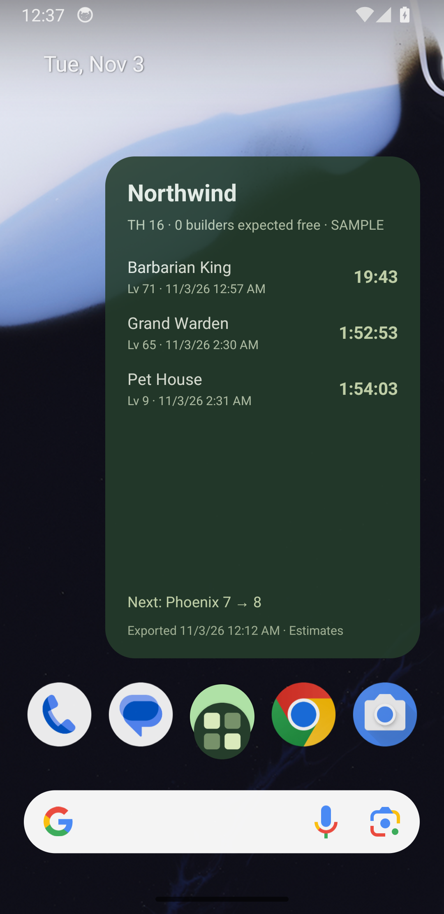
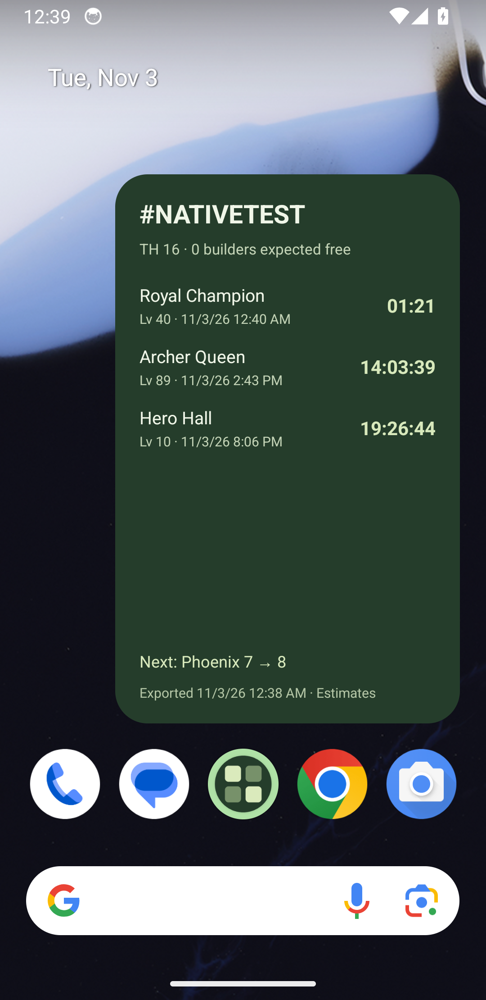

# Validation record

Checked locally on 2026-11-03. Commands use Node 22; native Android checks use the installed Android SDK and an ARM64 emulator. Keep outcomes distinct from public release readiness.

| Check | Outcome |
| --- | --- |
| `npm run typecheck` | Pass. |
| `npm test` | 15 domain regressions pass. |
| `npm run build:web` | Production bundle exports. |
| `npm run test:browser` | Seven browser flows pass in Chrome, including 390×844 phone and 1440×1050 desktop layouts. |
| `npx expo export --platform ios` | iOS JavaScript/Hermes bundle exports. |
| `npx expo prebuild --no-install` | Both native projects generate; local Android widget module autolinks. |
| `npm run check:widget-layout` | Isolated iOS widget registry generates. |
| `:coc-widget-native:compileDebugKotlin` | Android native module compiles. |
| `:app:assembleRelease -PreactNativeArchitectures=arm64-v8a` | Standalone Android APK builds locally. It uses the development signing key, not a distribution identity. |
| Android app/widget on emulator | **Pass in the tested configuration:** Pixel 3a ARM64, Android API 34, Pixel launcher. Standalone app launch, native configuration, script handoff/review/save, widget refresh, countdown/date/freshness and account isolation observed. |
| Full iOS native compilation and widget on device/simulator | **Not verified.** Full Xcode is not installed on this machine. The manual native CI workflow provides a compilation check when run. |
| Physical-device import Shortcut, share sheet, OS throttling, accessibility sizes and DST | **Not verified.** Remain release goals. |

## What the domain checks establish

Complete counted/nested parsing; raw unknown-field retention; validation of invalid counts/times; partial-snapshot history; duplicate/older import rejection; backup validation; application-link round trips; incoming/outgoing catalogue price conventions; boost timing anchored to export time; non-retroactive potion comparison; worker isolation and online hours; queued laboratory prerequisites; invalid/protected war deadlines; independent widget account data and bounded iOS timelines.

The public fixtures contain 423 building objects, 325 walls, 12 nested module records and 13 timed entries. A fixture comparison observes 62 wall levels gained. These are regression examples, not evidence that every live-game mechanic is supported.

## What the browser checks establish

Today → add to plan → army explanation; equipment target/balance persistence; history/profile isolation; rejected and accepted import with raw-field preservation; all five phone screens without horizontal page overflow; corrupted-storage preservation followed by explicit reset; exported backup and explicit replacement restoring preferences. Screenshots in `docs/screenshots/` are from the real app in sample mode.

## Reproduce native checks

```sh
npx expo prebuild --no-install
npm run check:widget-layout
# With a configured Android SDK/JDK:
cd android
./gradlew :app:assembleDebug --no-daemon --console=plain
```

Use the manual **Native compilation** GitHub workflow for Android and macOS/iOS builds. That workflow has been added, but its hosted execution is not claimed as checked until it actually runs. Generated native projects, signing material and APKs are not committed.

## Android observations

The installed standalone app persists its workspace across an APK update. A modified public fixture, explicitly tagged `#NATIVETEST`, is handed off with `scripts/import-link.mjs` as an approximately 11.7 KB local application URL. It opens directly at review, and Save is reachable without scrolling past the JSON entry form. Saving a newer fixture with a synthetic two-minute Royal Champion timer updates that village's installed widget, including the timer, absolute deadline and export date. Configuring Northwind while a different village is active leaves Northwind selected; changing the app account also leaves the widget selection intact.

After switching the app to Little village and returning to the launcher, the widget still shows `#NATIVETEST`. At the synthetic timer boundary, its Royal Champion row disappears and the expected-free-builder count changes to one. This confirms the best-effort boundary refresh in this emulator session; it is not a confirmation of any in-game completion or a guarantee under Doze.

The final widget supplies separate portrait and landscape layouts. Portrait rendering with three rows is inspected. **Not verified:** actual landscape rotation, all resize sizes, two installed widget instances at once, alternate launchers and prolonged Doze/battery restrictions. These remain follow-up device checks. Shared projection tests establish account independence separately from these observations.






The full catalogue, special operations and speed effects require the live-data audit in [GOALS.md](GOALS.md). A build passing does not establish exact live-game values, OS widget delivery timing or store readiness.
