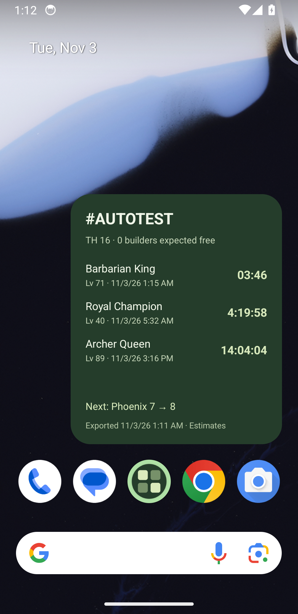

# Validation record — widget/automation scope

Current work removes the website and prioritizes Android. Historical browser checks do not apply to the deleted dashboard. Keep native compilation, JavaScript exports, synthetic source automation and live Clash export separate.

## Current checks

| Check | Outcome |
| --- | --- |
| TypeScript | Pass. |
| Domain/automation tests | 25 pass, including serialized save/publish/ack, idempotence, failed publication retry, fresh/wrong-village guards, atomic-file watch and profile validation. |
| Native JavaScript exports | Android and iOS exports pass after the website removal. |
| Updated Android native compilation | Pass: debug build and standalone ARM64 release preview (development signing key). Standalone receiver also tested with Metro stopped. |
| Updated automatic file/clipboard receiver on emulator | Pass: enablement gate, file delivery, cold receiver start, atomic-file watcher and installed-widget update without a Save prompt. |
| Export-menu runner using synthetic development source | Pass: interactive calibration, Settings/More Settings/Copy/menu cleanup, fresh clipboard validation and native widget acknowledgement. |
| Export-menu calibration against real Clash client | Not verified; no live client/device profile has been established here. |
| Full iOS compilation/device testing | Not verified; deferred to the iOS phase. |

## Prior native widget observations

The earlier standalone APK was tested on Pixel 3a ARM64 / Android API 34 / Pixel launcher. It rendered native countdowns, absolute completion dates, export freshness and next action. An accepted synthetic import updated an installed widget. App account changes did not alter its configured village. At a synthetic completion boundary the timer row disappeared and expected-free builders increased.

The updated debug app was then installed on the same isolated API 34 emulator. With automation disabled, the real CLI received a disabled result and exited with failure. After one-time enablement, `npm run sync -- --file …` received `updated` with a native widget acknowledgement and returned the app to background. No Save prompt was shown.

An actual launcher widget was configured for `#AUTOTEST`. The companion was force-stopped, then a real `--watch` process woke it and republished the duplicate snapshot. Atomically replacing the watched file with a newer synthetic five-minute builder timer produced `updated`; the installed widget showed the new timer and export date.

The real calibration wizard recorded four menu taps against a clearly labeled development fixture. The `export:android --profile … --test-source` CLI then ran those taps unattended, copied a current export, validated the timestamp and expected tag, saved it and received a widget acknowledgement. This establishes the complete source-menu/clipboard/delivery chain **with a synthetic source**. Two unattended cycles of the actual `--interval 60` runner also completed with fresh exports and widget acknowledgements, then the loop was stopped. No live Clash client/profile is being claimed.

The runner initially queried an Android window section without `mCurrentFocus`; actual device output showed that API 34 exposes it under `window displays`. The corrected query and focused-window regression pass.

## Reproduce

```sh
npm run check
npx expo prebuild --platform android --no-install
cd android
./gradlew :app:assembleDebug --no-daemon --console=plain
```

The manual Native compilation CI workflow can also build Android and an unsigned iOS simulator target. Its hosted execution is not implied by local checks.

## Standalone and large-file check

The release-preview APK was installed over the debug app. The file watcher and native development server were stopped, and the companion process was force-stopped. The one-shot sync CLI then transferred a 307,618-byte synthetic export through the file transport and received `updated` / native widget acknowledgement. The installed launcher widget displayed the new four-minute timer and source date. This confirms that neither Metro nor a website is required for automatic delivery, and that transfer works beyond ordinary command-line URL sizes.

The test emulator has no installed `com.supercell.clashofclans` package. Live-game menu calibration and long-running behavior on a real user's unlocked device remain unverified. The synthetic source is guarded by `__DEV__`; release behavior does not expose it.


