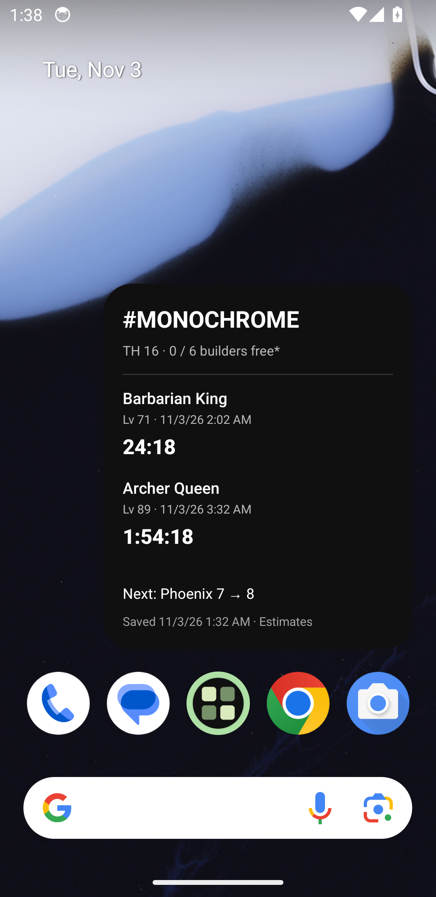
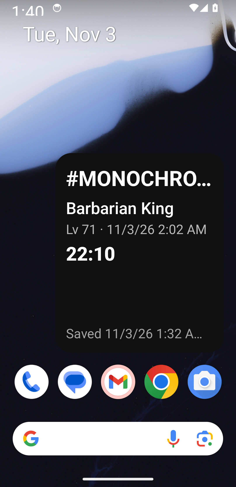

# Validation record — widget/automation scope

Current work removes the website and prioritizes Android. Historical browser checks do not apply to the deleted dashboard. Keep native compilation, JavaScript exports, synthetic source automation and live Clash export separate.

## Current checks

| Check | Outcome |
| --- | --- |
| TypeScript | Pass. |
| Domain/automation/platform tests | 41 pass, including paired authorization, size/depth limits, cancellation, file bounds, generated Scriptable execution and RemoteViews class restrictions. |
| Native JavaScript exports | Android and iOS exports pass after the website removal. |
| Updated Android native compilation | Pass: debug build and standalone universal release preview with ARMv7, ARM64, x86 and x86_64 (development signing key). Standalone receiver also tested with Metro stopped. |
| Updated automatic file/clipboard receiver on emulator | Pass: enablement gate, file delivery, cold receiver start, atomic-file watcher and installed-widget update without a Save prompt. |
| Export-menu runner using synthetic development source | Pass: interactive calibration, Settings/More Settings/Copy/menu cleanup, fresh clipboard validation and native widget acknowledgement. |
| Export-menu calibration against real Clash client | Not verified; no live client/device profile has been established here. |
| Native iOS compilation | Pass: app and widget compile unsigned for simulator on GitHub macOS/Xcode, commit `53c67be`. Physical installation/behavior remains unverified. |
| Isolated iOS widget SDK runtime | 42 states pass: three sizes, full-color/accented, overview/selected/removed villages, active/expired timers and empty state. |
| Scriptable iPhone alternative | Bundle generation and simulated API execution pass. No physical iPhone claim. |

## Prior native widget observations

The earlier standalone APK was tested on Pixel 3a ARM64 / Android API 34 / Pixel launcher. It rendered native countdowns, absolute completion dates, export freshness and next action. An accepted synthetic import updated an installed widget. App account changes did not alter its configured village. At a synthetic completion boundary the timer row disappeared and expected-free builders increased.

The updated debug app was then installed on the same isolated API 34 emulator. With automation disabled, the real CLI received a disabled result and exited with failure. After one-time enablement, `npm run sync -- --file …` received `updated` with a native widget acknowledgement and returned the app to background. No Save prompt was shown.

An actual launcher widget was configured for `#AUTOTEST`. The companion was force-stopped, then a real `--watch` process woke it and republished the duplicate snapshot. Atomically replacing the watched file with a newer synthetic five-minute builder timer produced `updated`; the installed widget showed the new timer and export date.

The real calibration wizard recorded four menu taps against a clearly labeled development fixture. The `export:android --profile … --test-source` CLI then ran those taps unattended, copied a current export, validated the timestamp and expected tag, saved it and received a widget acknowledgement. This establishes the complete source-menu/clipboard/delivery chain **with a synthetic source**. Two unattended cycles of the actual `--interval 60` runner also completed with fresh exports and widget acknowledgements, then the loop was stopped. No live Clash client/profile is being claimed.

The runner initially queried an Android window section without `mCurrentFocus`; actual device output showed that API 34 exposes it under `window displays`. The corrected query and focused-window regression pass.

## Reproduce

```sh
npm run check
npx expo prebuild --platform android --no-install
cd android
./gradlew :app:assembleDebug --no-daemon --console=plain
```

The manual Native compilation CI workflow can also build Android and an unsigned iOS simulator target. Its hosted execution is not implied by local checks.

## Standalone and large-file check

The release-preview APK was installed over the debug app. The file watcher and native development server were stopped, and the companion process was force-stopped. The one-shot sync CLI then transferred a 307,618-byte synthetic export through the file transport and received `updated` / native widget acknowledgement. The installed launcher widget displayed the new four-minute timer and source date. This confirms that neither Metro nor a website is required for automatic delivery, and that transfer works beyond ordinary command-line URL sizes.

The test emulator has no installed `com.supercell.clashofclans` package. Live-game menu calibration and long-running behavior on a real user's unlocked device remain unverified. The synthetic source is guarded by `__DEV__`; release behavior does not expose it.


## November 3 audit and monochrome design

The rebuilt standalone app was installed on the API 34 emulator. A real CLI import with a wrong pairing code failed; the correct private code saved the export and received a native publication acknowledgement, with Metro stopped. Actual Home Screen placement exercised the owned-widget configuration check. The first design build exposed an unsupported plain `View` divider: native compilation passed but the launcher could not inflate the widget. Replacing it with `TextView` fixed rendering; the final APK was reinstalled and the actual widget inspected. A platform restriction regression now covers this failure. This also illustrates why publication acknowledgement alone cannot prove a launcher rendered a widget.

The corrected black/white widget displays village identity, expected builders, two countdowns, absolute finish times, next upgrade and export freshness. At 200% system text scaling it reduces to one timer, ellipsizes long text and hides secondary metadata; the footer can truncate. System font size was restored afterward. Arbitrary launcher sizes, rotation, full TalkBack navigation and physical OEM behavior remain unverified. Attempts to resize did not establish a separate compact size, so the screenshots are not evidence of minimum-height rendering.

The iOS job [compiled the app and extension successfully](https://github.com/Mosesml/COCWidget/actions/runs/41590410789/job/125765593709). The Android job in that first run failed before compilation because setup-android requested the obsolete `tools` SDK package. Its configuration now requests platform-tools, API 37, build-tools 37 and the pinned NDK explicitly. Local release/debug Android compilation passes.





## Large-workspace persistence and universal APK

The immutable file-generation repository migrated the old SQLite workspace, imported four large synthetic snapshots, and retained 2,923,996 bytes of history. After force-stopping the app, duplicate file delivery cold-started it, read that history and returned `unchanged` with native publication acknowledgement. The old large AsyncStorage row was removed, leaving a 41-character pointer. Tests cover file/pointer failures retaining the previous generation, legacy migration and explicit recovery while current storage is unreadable.

Universal Android compilation passes for `armeabi-v7a`, `arm64-v8a`, `x86` and `x86_64`. APK inspection confirms all four architectures, minimum API 24, target API 36 and compile API 37. The final config blocks overlay and broad external-storage permissions; only ARM64 runtime behavior is tested. Hosted SDK setup now pins current command-line tools and the exact `platforms;android-37.0` repository package.

APK inspection after permission cleanup lists Internet, Vibrate and the generated non-exported-receiver permission; SYSTEM_ALERT_WINDOW, READ_EXTERNAL_STORAGE and WRITE_EXTERNAL_STORAGE are absent.

Actual recovery was then tested: after backing up and intentionally corrupting only the synthetic file generation, the app showed its unreadable-data state. Selecting the 2.92 MB JSON through the system Downloads picker and confirming Restore recovered one village with five snapshots and republished the widget. No reset or manual repair was needed. The permission-restricted universal APK was then installed for the final delivery check. APK zip alignment passes the 16 KB packaging check (`zipalign -c -P 16 4`); no 16 KB-page device runtime claim is made.

Final permission-restricted universal APK: installed successfully, app force-stopped, existing large export delivered through the real CLI, workspace loaded from its private file, and `unchanged` / native publication acknowledgement received. This establishes that broad storage/overlay permissions are unnecessary for the implemented sync path.

The final paired clipboard path was also rerun after storage/security changes: rebuilt debug app → the calibrated development-only Settings/More Settings/Copy source → fresh `#AUTOTEST` JSON → paired clipboard receiver → file-backed persistence → native widget acknowledgement. It passed. The standalone release preview was reinstalled afterward, and the temporary native packager/tunnel/test emulator were stopped. This remains a synthetic source test, with no live Clash profile claimed.

## Final hosted verification

Both jobs in [Native compilation](https://github.com/Mosesml/COCWidget/actions/runs/41593191976) pass at final code commit `53c67be`: Android debug compilation across the default ABI set and the unsigned iOS app/extension simulator build. The SDK setup correction is verified on the hosted runner. Main-branch App checks also pass, including 41 automated tests, production Android/iOS JavaScript exports, regenerated Scriptable artifact consistency and 42 iOS SDK runtime layout states.
